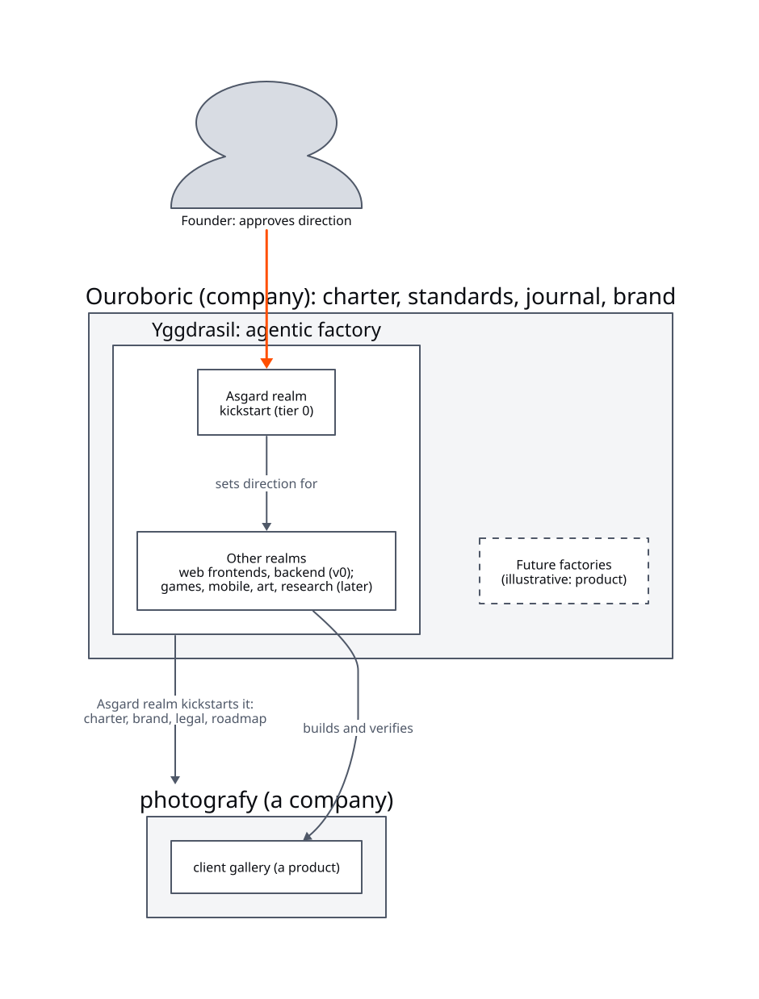

# Ouroboric charter

This charter sets the highest-level direction for Ouroboric (ouroboric.dev) and everything it builds.
Every product charter must conform to it.

## Vision

A world where anyone can steer systems that build, learn and improve themselves: openly, measurably
and safely.

## Mission

Build open, self-improving factories, starting with software and companies, that anyone can run,
adapt and trust.

## What "ouroboric" means

Every Ouroboric product is a factory that produces work, measures it and feeds what it learns back
into itself. That loop is the Ouroboros, the serpent eating its own tail. A product is ouroboric
when it:

1. **improves itself** through its own loop, measured run against run;
2. **documents itself** the way it documents what it produces;
3. **never weakens its own guardrails** while it improves.

## Principles

1. **Humans steer, agents build.** Anyone running a factory approves its direction. Work within
   approved direction runs automatically; any deviation from it stops.
2. **Checks, not promises.** Verify claims mechanically wherever possible. Saying "done" proves
   nothing.
3. **Measure everything.** Every run produces evidence, and every claim about a factory rests on runs.
4. **Safe by default.** Grant least access, keep hard stops that can't be switched off, and design
   against cascades instead of discovering them.
5. **Learn in public.** Record challenges, decisions and results honestly, including failures, and
   share them.
6. **Read before you borrow.** Learn from others freely; reuse their work only as their licences allow;
   credit what we take.
7. **Narrow first.** Grow from specific, working factories and extract what is truly shared.

## Values and culture

- **Curiosity over certainty:** we build to learn, and say what we don't know.
- **Honesty about results:** numbers over adjectives; the failed experiment gets written up too.
- **Craft and simplicity:** less code, fewer concepts, clear names.
- **Openness:** open source by default, private only by choice.
- **Respect for creators:** licences, credit and consent matter, for code, writing, art and data.

## Portfolio

<!-- diagram: assets/diagrams/ouroboric-portfolio.d2 -->
<picture>
  <source media="(prefers-color-scheme: dark)" srcset="../assets/diagrams/rendered/ouroboric-portfolio.dark.svg">
  
</picture>

Ouroboric has one defined factory, Yggdrasil, with two kinds of realm. **Amended on 2026-10-17:**
Asgard, defined until then as a second factory, became Yggdrasil's kickstart realm.

| Factory and realm | Produces | Status |
|---|---|---|
| **Yggdrasil**, build realms (Midgard and Helheim first) | software | in build (v0) |
| **Yggdrasil**, Asgard realm | companies and products: charters, brands, legal basics, roadmaps, readiness | designed; v0 after Yggdrasil v0 |

Focus stays on what is defined. Anything else is an illustration of where Ouroboric could go, **not
a commitment**: a product factory between Asgard and Yggdrasil. **Amended on 2026-10-17:** research
and art, illustrated until then as factories of their own, became two of Yggdrasil's nine realms:
Vanaheim (research: syntheses and papers) and Alfheim (art: assets for apps and games, and later art
as the work itself). They are named, not committed; the roadmap says when a realm is built. Yggdrasil
is now called the agentic factory, since its realms make more than software.

## North-star measures

- **Each factory measurably improves per iteration** on its own benchmarks: hidden acceptance score,
  first-pass rate and cost per task, run against run.
- **Factories in real use**, by us and by others.
- **Lessons shared:** journal entries with measured results, and later published posts.

## Boundaries

- **Learning first.** Making money is not a goal for Ouroboric for now. Others may use the factories
  commercially under their licences.
- **Open source** for the factories: AGPL-3.0 for factory code, MIT for anything copied into what
  operators build, CC BY 4.0 for docs; names and logos reserved ([legal](legal/README.md)). What the
  factories produce belongs to the operators and may be public or private, at their choice.
- **Focus:** Yggdrasil, with its Asgard realm, before any new factory.
- **Cost-conscious:** subscriptions and free tiers first, hard budget caps everywhere.
