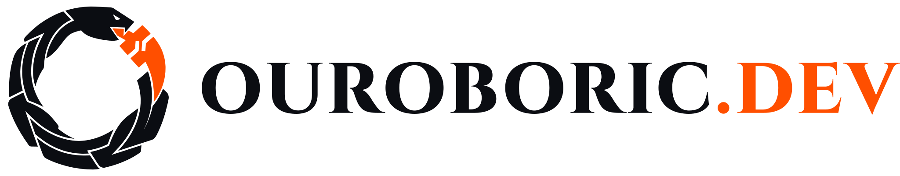

# Identity

The Ouroboric design language. Dark mode comes first; light mode is equally supported.

## Palette

**Decided 2026-10-11:** Midnight neutrals with **International Orange** (`#FF4F00`) as the single
accent.

| Token | Dark (default) | Light | Use |
| --- | --- | --- | --- |
| `bg` | `#0B0D12` | `#FFFFFF` | page background |
| `surface` | `#14171F` | `#F4F5F7` | panels, code, sidebars |
| `border` | `#2A303C` | `#D8DCE3` | dividers and outlines (decorative) |
| `text` | `#EDEFF3` | `#0B0D12` | body text |
| `muted` | `#9AA3B2` | `#4F5868` | secondary text |
| `accent` | `#FF4F00` | `#FF4F00` | brand colour: logo, buttons, approval points, highlights |
| `accent-text` | `#FF4F00` | `#B83A00` | accent used as text, such as links |
| `on-accent` | `#0B0D12` | `#0B0D12` | text and icons on an accent fill |
| `ok` | `#3FB950` | `#1A7F37` | passed status |
| `warn` | `#D29922` | `#9A6700` | warning status |
| `crit` | `#F85149` | `#CF222E` | failed status |

The tokens are machine-readable in [`tokens.css`](tokens.css) and [`tokens.json`](tokens.json).
Docs themes, diagrams and realm templates take their colours from these files.

## Rules

1. **Text on orange is Midnight, never white.** Midnight on International Orange is 5.9:1 and passes
   WCAG AA; white on it is 3.3:1 and fails. This applies to buttons, approval points in diagrams, and
   the logo.
2. **Orange text on white uses `accent-text`.** `#FF4F00` on white is 3.3:1, enough for shapes but not
   for text; `#B83A00` is 5.8:1. On the dark background, `#FF4F00` passes as text (5.9:1).
3. **Orange means "brand" and "a human decides here".** It marks the logo, primary actions and
   approval points. Don't use it for errors; failed states use `crit`.
4. **Status colours stay separate** from the accent: passed, warning and failed use `ok`, `warn` and
   `crit`.

## Contrast

All pairs in the table pass WCAG AA for their use, in both modes: text pairs at 4.5:1 or more, the
accent as a shape at 3:1 or more.

| Pair | Dark | Light |
| --- | --- | --- |
| text on bg | 16.9:1 | 19.4:1 |
| muted on bg | 7.6:1 | 7.2:1 |
| accent-text on bg | 5.9:1 | 5.8:1 |
| on-accent on accent | 5.9:1 | 5.9:1 |
| accent (shape) on bg | 5.9:1 | 3.3:1 |

## Typography

**Decided 2026-10-11.** Every face is free under the SIL Open Font License (OFL 1.1). Each one has a
single job. The rarer the job, the more character the face can carry.

| Role | Face | Weights | Use |
| --- | --- | --- | --- |
| Wordmark | **Cinzel** | 800 | the name as a logo: `OUROBORIC.DEV`, with `.DEV` in `accent` |
| Display | **Fjalla One** | 400 | page titles, slide covers, social cards, posters |
| Initial | **Cinzel** | 800 | the drop cap that opens an article |
| Heading | **Literata** | 700, 600 | section headings in docs, specs and the journal |
| Body | **Literata** | 400, 400 italic, 700, 700 italic | running text |
| Interface | **Inter** | 400, 600 | buttons, labels, navigation, tables, numbers |
| Mono | **JetBrains Mono** | 400, 600 | code, CLI, logs, hashes, run IDs |
| Ornament | **Noto Sans Runic** | 400 | Elder Futhark runes: `ᛟᚢᚱᛟᛒᛟᚱᛁᚲ` spells OUROBORIC |

The system works like a newspaper. The Cinzel wordmark is the masthead, the condensed Fjalla One
titles are the headlines, and Literata carries the reading. A Cinzel initial opens each article.

The font stacks and the type scale are in [`tokens.css`](tokens.css) and [`tokens.json`](tokens.json).

### Type scale

The body is 17 px. Serif text reads better slightly larger than a sans at the same size.

| Token | Size | Line height | Face |
| --- | --- | --- | --- |
| `display-xl` | 3.5rem (56 px) | 1.05 | Fjalla One: slide covers, hero titles |
| `display` | 2.5rem (40 px) | 1.1 | Fjalla One: page titles (h1) |
| `h2` | 1.75rem (28 px) | 1.2 | Literata 700 |
| `h3` | 1.375rem (22 px) | 1.25 | Literata 700 |
| `h4` | 1.125rem (18 px) | 1.3 | Literata 600 |
| `body` | 1.0625rem (17 px) | 1.6 | Literata 400 |
| `ui` | 0.875rem (14 px) | 1.45 | Inter 400 or 600 |
| `caption` | 0.75rem (12 px) | 1.4 | Inter 400 |
| `mono` | 0.875em of its context | 1.5 | JetBrains Mono 400 |
| `initial` | three lines of body text | 0.8 | Cinzel 800 in `accent-text` |

### Type rules

1. **Cinzel appears only in the wordmark and in initials.** Never use it for headings or running
   text. Limiting Cinzel to rare moments keeps it memorable and keeps readers from tiring of it.
2. **One initial per article at most, in the plain style:** a Cinzel 800 letter in `accent-text`, three
   lines of body text tall, with no box or ring. Use it in journal entries, blog posts, the brand story
   and the charter. Reference docs and specs don't get one.
3. **Never fake a style.** Fjalla One has one weight and no italic. Set `font-synthesis: none` so
   browsers don't invent bold or italic. Load only the weights in the table above.
4. **Numbers in tables use Inter with tabular figures** (`font-variant-numeric: tabular-nums`) so
   columns line up.
5. **Runes are ornament only.** They never carry meaning that isn't also written in Latin letters.
   Mark them `aria-hidden="true"` or give them a `title`. Leave them out of terminal output, because
   most terminal fonts lack runic glyphs.
6. **Self-host the font files.** Serve them from our own domain, not from a font CDN at runtime.
   Every request to a third-party font CDN sends the visitor's IP address to that provider. In
   January 2022 a German court (LG München I, 3 O 17493/20) ruled that embedding Google Fonts this way
   breached the GDPR, which set off a wave of warning letters to site owners. The OFL allows
   redistribution. When font files are committed to a repo, add `LICENSES/OFL-1.1.txt` and a
   `REUSE.toml` entry for them.
7. **Diagrams use Inter and the token palette, in a light and a dark render.** The render script
   applies both; see [diagrams](../../4-ways-of-working/diagrams.md).
8. **Where our fonts don't reach, the brand is the name, the colour and the tone.** GitHub README
   text, chat link previews and terminals all use their own fonts. Banners and social cards therefore
   are images exported from the wordmark.

## Logo

**Decided 2026-10-12.** An ouroboros of carved, interlocking scales biting its orange tail, which
carries a gate, with the `OUROBORIC.DEV` wordmark in Cinzel 800. In dark mode the snake turns light
(`#EDEFF3`), so it never merges with the background; the tail stays International Orange in both
modes.

<picture>
  <source media="(prefers-color-scheme: dark)" srcset="logo/ouroboric-logo-horizontal-dark.svg">
  
</picture>

The files, usage rules and favicon are in [logo](logo/README.md); the proposals and explorations
behind them are in [logo concepts](logo/concepts/README.md). The logo files are trademarks, covered by
`TRADEMARKS.md` rather than the documentation licence.
